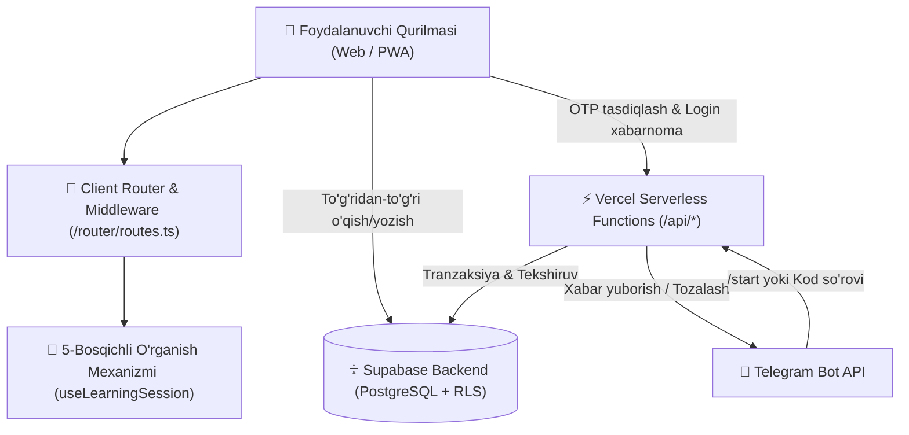
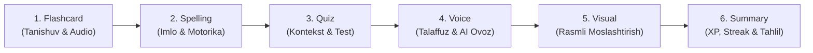

# 📚 LEXIS 4000 — 4000 Essential English Words Platformasi

> **LEXIS 4000** — Paul Nation muallifligidagi mashhur *"4000 Essential English Words"* 6 jildlik kitoblar to'plamiga asoslangan, neyrolingvistik 5 bosqichli so'z yodlash va mustahkamlash tizimiga ega zamonaviy ta'limiy veb-platforma.

---

## 🎯 Loyiha Maqsadi va Falsafasi

An'anaviy lug'at yodlash usullari ko'pincha so'zning qisqa muddatli xotirada qolib ketishiga va tez unutilishiga olib keladi. **LEXIS 4000** ushbu muammoni neyrolingvistik va ko'p sensorli yondashuv orqali hal qiladi:
- **Vizual xotira:** Har bir so'z yuqori sifatli rasmlar va kontekstual misollar bilan bog'langan.
- **Audial xotira:** Native talaffuz va ovoz chiqarib aytish mashqlari.
- **Kinetik/Motorika:** So'zni to'g'ri terish (spelling) mashqi.
- **Assotsiatsiyalar va Kontekst:** 4 variantli testlar va semantik bog'liqliklar.
- **Doimiy mustahkamlash:** Xatolar ustida ishlash (Mistakes Manager) va uzluksiz kunlik odat (Streak & Gamification).

---

## 🚀 Asosiy Imkoniyatlar (Features)

### 1. 📖 To'liq Kitoblar va Lug'at Bazasi
- **6 ta jild, 180 ta unit, 4000 ga yaqin saralangan so'zlar**.
- Har bir so'z uchun:
  - Xalqaro fonetik transkripsiya (IPA).
  - So'z turkumi (`noun`, `verb`, `adjective`, `adverb`).
  - Aniq va tushunarli o'zbekcha tarjima.
  - Ingliz tilidagi mukammal ta'rif (definition).
  - Kontekstual misol jumlalar (inglizcha va o'zbekcha tarjimasi bilan).
  - Rasmli illyustratsiya va native audio talaffuz.

### 2. 🧠 Neyrolingvistik 5+1 Bosqichli O'rganish Sikli
O'quvchi har bir unitdagi so'zlarni ketma-ket 5 ta faol bosqich orqali mustahkamlaydi:
1. **Phase 1: Flashcard** — So'zning kartochkasi, audio talaffuzi, transkripsiyasi va o'zbekcha tarjimasi bilan tanishuv.
2. **Phase 2: Spelling** — So'zni harfma-harf to'g'ri yozish mashqi (klaviatura yordamida motor xotirani rivojlantirish).
3. **Phase 3: Quiz** — Kontekst va ma'noga asoslangan 4 variantli test sinovi (aqlli chalg'ituvchi variantlar bilan).
4. **Phase 4: Voice (Talaffuz)** — Web Speech API orqali so'zni mikrofonga talaffuz qilish va real-vaqtda to'g'riligini aniqlash.
5. **Phase 5: Visual (Ko'rgazmali tahlil)** — So'z ma'nosiga mos rasmni 4 ta rasm ichidan vizual tanlab olish.
6. **Phase 6: Summary & Natijalar** — Sessiya yakuniy tahlili, o'zlashtirish foizi, XP hisobi, yangilangan streak va xatolar ro'yxati.

### 3. 🤖 Telegram Bot Orqali Parolsiz Autentifikatsiya (OTP)
- Foydalanuvchilarga murakkab parollarni eslab qolish shart emas.
- Telegram bot (`@...bot`) orqali 6 xonali bir martalik xavfsiz OTP kod generatsiya qilinadi.
- Serverless endpoint orqali tasdiqlanib, 24 soatlik xavfsiz sessiya yaratiladi.
- Tizimga kirilgach, botdagi vaqtinchalik xabarlar avtomatik tozalanadi.

### 4. 🎮 Gamifikatsiya va Odat Tizimi (Habit Formation)
- **XP (Experience Points):** To'g'ri bajarilgan har bir qadam va unit uchun tajriba ballari.
- **Streak Days (Kunlik uzluksiz zanjir):** Har kuni o'qish orqali streakni yo'qotmaslik motivatsiyasi.
- **Leaderboard (Reyting jadvali):** Barcha o'quvchilar o'rtasida umumiy va haftalik faollik reytingi.
- **Xatolar ustida ishlash (Mistakes Vault):** Noto'g'ri bajarilgan so'zlar alohida saqlanadi va ularni qayta mashq qilib xotiradan chiqarish mumkin.

### 5. 🛡️ Keng Qamrovli Admin Paneli (`/admin` yoki `/admin-uchun`)
- **Dashboard:** Umumiy ro'yxatdan o'tganlar, faol foydalanuvchilar, unit tugatilishlari va faollik tahlili.
- **Foydalanuvchilar boshqaruvi:** Qidirish, profillarni ko'rish, XP va streak ko'rsatkichlarini tahrirlash, ma'lumotlarni eksport qilish.
- **Telegram Broadcast Center:** Barcha foydalanuvchilarga yoki tanlangan guruhlarga Telegram bot orqali inline tugmali xabarnomalar yuborish.
- **4000 So'zlik Lug'at Explorer:** Barcha so'zlarni kitob/unit bo'yicha saralash, qidirish, audio va tarjimalarni ko'rish.

### 6. 📱 PWA & Adaptiv UI/UX
- Mobil va planshetlarga to'liq moslangan Bottom Bar navigatsiya.
- iOS va Android Safe Area insets bilan to'liq uyg'unlashgan status bar.
- Qorong'i (Dark), Yorug' (Light) va Tizim (System) mavzulari.
- Offline kesh va engil yuklanish (boshlang'ich JS bundle hajmi < 200KB).

---

## 📐 Tizim Arxitekturasi



---

## 🔄 5+1 O'rganish Bosqichlari Zanjiri



---

## 📂 Loyihaning Katalog Strukturasi

```
lexis-4000/
├── api/                       # Vercel Serverless Endpointlari (Backend vazifasini bajaradi)
│   ├── admin-broadcast.ts     # Telegram bot orqali ommaviy xabar yuborish
│   ├── broadcast-goals.ts     # Maqsad va eslatmalarni jo'natish
│   ├── notify-login.ts        # Kirish muvaffaqiyatli bo'lganda bot chatini tozalash
│   ├── streak-reminder.ts     # Kunlik streak eslatmalarini jo'natuvchi Cron endpoint
│   ├── verify-code.ts         # Telegram OTP kodini xavfsiz tasdiqlash
│   └── webhook.ts             # Telegram bot webhook qabul qiluvchisi
├── public/                    # Statik fayllar (Favicon, rasmlar, audiolar, manifest)
│   ├── avatars/               # Foydalanuvchi avatarlari kolleksiyasi
│   ├── images/books/          # 6 ta kitobning muqova suratlari
│   ├── sounds/                # To'g'ri (correct) va noto'g'ri (wrong) audio effektlari
│   └── manifest.json          # PWA konfiguratsiyasi
├── scripts/                   # Yordamchi skriptlar
│   └── telegramBot.ts         # Telegram botining uzoq muddatli yoki lokal ishga tushirish skripti
├── src/
│   ├── assets/                # Veb-ilova logotiplari va rasmlari
│   ├── components/            # Asosiy UI sahifalar va komponentlar
│   │   ├── AdminPage.tsx      # Admin boshqaruv paneli (Dashboard, Broadcast, Lug'at)
│   │   ├── BookCatalog.tsx    # 6 ta kitob katalogi
│   │   ├── UnitSelector.tsx   # Tanlangan kitobning 30 ta uniti ro'yxati
│   │   ├── WordSelector.tsx   # Unitdagi 20 ta so'z ro'yxati va holati
│   │   ├── LoginPage.tsx      # Telegram orqali OTP kirish sahifasi
│   │   ├── ProfilePage.tsx    # Foydalanuvchi profili, statistikasi va sozlamalari
│   │   ├── LeaderboardPage.tsx# Foydalanuvchilar reytingi jadvali
│   │   ├── MistakesPage.tsx   # Xato qilingan so'zlar ustida ishlash xonasi
│   │   ├── Navbar.tsx         # Yuqori navigatsiya paneli (XP, streak, tema)
│   │   ├── MobileBottomNav.tsx# Mobil qurilmalar uchun pastki menyu
│   │   └── learning/          # 5+1 o'rganish bosqichlari komponentlari
│   │       ├── Phase1Flashcard.tsx
│   │       ├── Phase2Spelling.tsx
│   │       ├── Phase3Quiz.tsx
│   │       ├── Phase4Voice.tsx
│   │       ├── Phase5Visual.tsx
│   │       └── Phase6Summary.tsx
│   ├── data/                  # 4000 ta so'z ma'lumotlar bazasi va loader
│   │   ├── book1Words.ts ... book6Words.ts
│   │   ├── wordLoader.ts      # Dinamik On-Demand keshlovchi yuklovchi
│   │   └── avatars.ts         # Standart avatarlar ro'yxati
│   ├── hooks/
│   │   └── useLearningSession.ts # O'quv sessiyasi holatini boshqaruvchi hook
│   ├── lib/
│   │   └── supabase.ts        # Supabase mijozi va TypeScript interfeyslari
│   ├── router/
│   │   └── routes.ts          # SPA routing & Middleware himoyasi
│   ├── utils/
│   │   ├── mistakeManager.ts  # Xatolarni hisobga olish va keshda saqlash
│   │   ├── sessionManager.ts  # 24 soatlik xavfsiz sessiya boshqaruvi
│   │   ├── soundEffects.ts    # Web Audio effektlari ijrosi
│   │   ├── speech.ts          # Web Speech API (TTS & Speech Recognition)
│   │   ├── streakManager.ts   # Kunlik streak va faollik kalendari
│   │   └── telegramAuth.ts    # Telegram OTP API bilan integratsiya
│   ├── App.tsx                # Ilovaning markaziy ildiz komponenti
│   ├── main.tsx               # React DOM kirish nuqtasi
│   └── index.css              # Global stillar va Tailwind v4 direktivalari
├── .env.example               # Atrof-muhit o'zgaruvchilari namunasi
├── nginx.conf.example         # Production Nginx SPA sozlamasi
├── package.json               # Bog'liqliklar va buyruqlar
├── tsconfig.json              # TypeScript sozlamalari
├── vercel.json                # Vercel URL rewrite qoidalari
└── vite.config.ts             # Vite konfiguratsiyasi
```

---

## 🛠️ Texnologik Stak

| Bo'lim | Texnologiya | Izoh |
|---|---|---|
| **Frontend Framework** | React 19 (`react` 19.2.x) | Zamonaviy komponentli arxitektura |
| **Til** | TypeScript 6.x | To'liq tip xavfsizligi |
| **Build Tool** | Vite 8 (`vite` 8.3.x) | O'ta tezkor HMR va yengil build |
| **Styling** | Tailwind CSS v4 (`@tailwindcss/vite`) | Zamonaviy CSS-in-CSS dizayn tizimi |
| **Ikonkalar** | Lucide React | Minimalistik va yuqori sifatli SVG ikonkalar |
| **Database & Auth** | Supabase (PostgreSQL) | Bulutli ma'lumotlar bazasi, RLS himoyasi |
| **Serverless API** | Vercel Functions | Node.js asosidagi mikroservislar |
| **Ovoz va Nutq** | Web Speech API | Brauzerning o'zida ovozni tanish va o'qish |
| **PWA & Caching** | Service Worker / Web App Manifest | Mobil ilova kabi o'rnatish imkoniyati |
| **Linter** | Oxlint (`oxlint` 1.81.x) | Rust asosidagi chaqmoqdek tez linter |

---

## 🔌 API Endpointlari (Serverless Functions)

| Endpoint | Metod | Tavsif | Kirish parametrlari |
|---|---|---|---|
| `/api/verify-code` | `POST` | Telegram OTP kodini tekshirish va profilni qaytarish | `{ code: string }` |
| `/api/notify-login` | `POST` | Tizimga muvaffaqiyatli kirilgach, botdagi kod xabarlarini tozalash | `{ telegram_id: number, message_ids: number[] }` |
| `/api/admin-broadcast` | `POST` | Telegram orqali barcha foydalanuvchilarga xabar tarqatish | `{ title, message, button_text, button_url, target_type }` |
| `/api/streak-reminder` | `GET/POST` | Kun davomida kirmagan o'quvchilarga botdan eslatma jo'natish (Cron) | - |
| `/api/webhook` | `POST` | Telegram botning kiruvchi xabarlarini qabul qiluvchi webhook | Telegram Update obyekti |

---

## 🗄️ Ma'lumotlar Modeli (Database Schema)

### `profiles` (Foydalanuvchilar jadvali)
```typescript
interface UserProfile {
  id: string;               // UUID (Supabase User ID)
  telegram_id?: number;     // Foydalanuvchining Telegram ID si
  phone_number?: string;    // Telefon raqami
  username?: string;        // Telegram username
  full_name: string;        // To'liq ismi / Taxallusi
  avatar_url?: string;      // Tanlangan avatar manzili
  total_xp: number;         // To'plangan umumiy XP
  streak_days: number;      // Uzluksiz kunlik streak soni
  last_study_date?: string; // Oxirgi faollik sanasi (YYYY-MM-DD)
  created_at?: string;      // Ro'yxatdan o'tgan vaqt
}
```

### `unit_progress` (O'zlashtirish jadvali)
```typescript
interface UnitProgress {
  id?: number;
  user_id: string;
  book_number: number;      // 1..6
  unit_number: number;      // 1..30
  accuracy_percentage: number; // 0..100%
  is_completed: boolean;    // Yakunlanganlik holati
  completed_at?: string;
}
```

### `words` (So'zlar strukturasi)
```typescript
interface Word {
  id: string;               // Masalan: "b1_u1_w1"
  book_number: number;      // 1..6
  unit_number: number;      // 1..30
  word: string;             // Masalan: "arrive"
  phonetic: string;         // Masalan: "/əˈraɪv/"
  part_of_speech: string;   // "verb", "noun", etc.
  translation_uz: string;   // O'zbekcha tarjimasi
  definition_en: string;    // Inglizcha ta'rifi
  example_en: string;       // Inglizcha misol
  example_uz?: string;      // O'zbekcha misol
  image_url: string;        // Surat havolasi
  audio_url: string;        // Audio havolasi
}
```

---

## 📦 O'rnatish va Ishga Tushirish

### Talablar (Prerequisites)
- **Node.js** >= 20.x
- **npm** >= 10.x yoki **pnpm** / **bun**
- **Supabase** loyihasi (URL va Anon Key)
- **Telegram Bot Token** (@BotFather orqali olingan)

### Bosqichma-bosqich qo'llanma

1. **Repozitoriyani klon qiling va loyiha papkasiga kiring:**
   ```bash
   git clone https://github.com/username/lexis-4000.git
   cd lexis-4000
   ```

2. **Bog'liqliklarni o'rnating:**
   ```bash
   npm install
   ```

3. **Muhit o'zgaruvchilarini sozlang:**
   `.env.example` faylidan nusxa olib `.env` yarating:
   ```bash
   cp .env.example .env
   ```
   Faylni ochib kerakli kalitlarni kiriting:
   ```env
   TELEGRAM_BOT_TOKEN=1234567890:ABCdefGHIjklMNOpqrSTUvwxyz
   VITE_SUPABASE_URL=https://your-project.supabase.co
   VITE_SUPABASE_ANON_KEY=your_supabase_anon_key_here
   ```

4. **Dasturni ishlab chiqish rejimida ishga tushiring:**
   ```bash
   npm run dev
   ```
   Brauzeringizda oching: `http://localhost:5173`

5. **Ishlab chiqarishga tayyorlash (Production Build):**
   ```bash
   npm run build
   ```

6. **Kodni tekshirish (Linting):**
   ```bash
   npm run lint
   ```

---

## 🌐 Serverga Joylash (Deployment)

### Vercel orqali (Tavsiya etiladi)
Loyiha tuzilishi Vercel Serverless arxitekturasiga to'liq moslashtirilgan.
1. Loyihani GitHub'ga yuklang.
2. Vercel dashboardida loyihani import qiling.
3. Environmental Variables bo'limida `TELEGRAM_BOT_TOKEN`, `VITE_SUPABASE_URL` va `VITE_SUPABASE_ANON_KEY` ni qo'shing.
4. Deploy tugmasini bosing. `vercel.json` avtomatik tarzda SPA marshrutlash va API routingni o'rnatadi.

### Nginx (O'z serveringiz / VPS orqali)
1. `npm run build` orqali `dist/` papkasini hosil qiling.
2. `nginx.conf.example` faylidagi konfiguratsiyani `/etc/nginx/sites-available/lexis4000` ga joylang.
3. Saytni aktivlashtirib, Nginx'ni qayta ishga tushiring:
   ```bash
   sudo ln -s /etc/nginx/sites-available/lexis4000 /etc/nginx/sites-enabled/
   sudo nginx -t && sudo systemctl reload nginx
   ```

---

## 🔒 Xavfsizlik va Optimal Unumdorlik
- **OTP Brute-Force himoyasi:** Bir martalik kodlar faqat serverless API orqali tekshiriladi, client tomonida ochiq kalitlar qoldirilmagan.
- **Lazy Loading & Memory Optimization:** 4000 ta so'zdan iborat og'ir JSON fayllar dastur ochilishida emas, faqat kerakli kitob tanlanganda dinamik `import()` orqali yuklanadi.
- **Audio Preload:** O'rganish paytida keyingi so'z va unga oid rasmlar oldindan xotiraga yuklanib (preload), tarmoqdagi sekinlashuvlarning oldi olinadi.

---

## 👨‍💻 Muallif va Litsenziya
- **Loyiha nomi:** LEXIS 4000
- **Domen:** [lexis4000.uz](https://www.lexis4000.uz)
- **Asos:** Paul Nation — *"4000 Essential English Words"*
